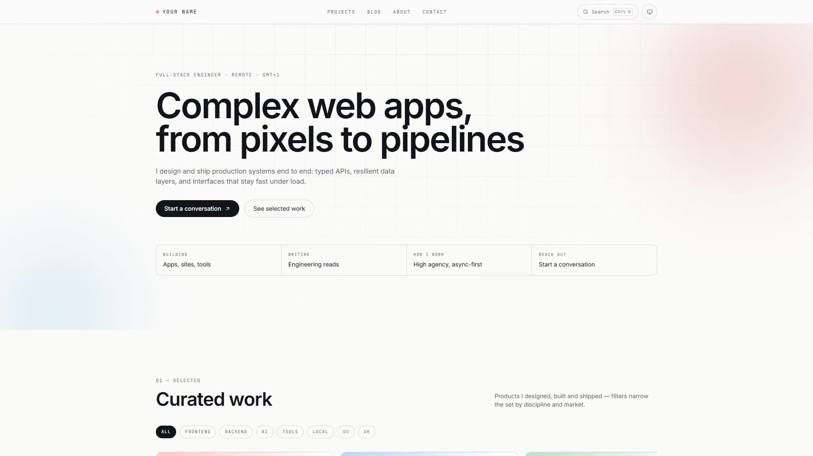

# Facet

[](https://github.com/T0b0i7/portfolio-rebuild/actions/workflows/ci.yml)
[](https://github.com/T0b0i7/portfolio-rebuild/actions/workflows/deploy.yml)
[](./LICENSE)
[](https://nextjs.org)

**Facet** est un template de portfolio **open source**, 100 % statique, prêt pour
**GitHub Pages**. Plusieurs facettes pour un seul site — projets, écrits, usages, liens — et un
thème clair/sombre qui bascule d'un clic sur une icône passant de l'écran à la lune.

- **Démo en ligne** : https://t0b0i7.github.io/portfolio-rebuild/
- **Vidéo de démo** (15 s, 1080p) : [`video/portfolio-demo.mp4`](video/portfolio-demo.mp4)

[](video/portfolio-demo.mp4)

Aucune base de données, aucun serveur : le build produit un dossier `out/` servi tel quel par
GitHub Pages. La CI vérifie chaque pull request, le déploiement part automatiquement de `master`.

## Sommaire

- [Pourquoi Facet](#pourquoi-facet) · [Fonctionnalités](#fonctionnalités) · [Stack](#stack)
- [Démarrer](#démarrer) · [Architecture](#architecture) · [Modèle de contenu](#modèle-de-contenu)
- [Mode sombre](#mode-sombre) · [Personnalisation](#personnalisation)
- [Déploiement GitHub Pages](#déploiement-github-pages) · [CI/CD](#cicd)
- [SEO, performance, accessibilité](#seo-performance-accessibilité) · [Scripts](#scripts)
- [Dépannage](#dépannage) · [Feuille de route](#feuille-de-route) · [Contribuer](#contribuer) · [Licence](#licence)

---

## Pourquoi Facet

Un portfolio montre plusieurs **facettes** d'un même parcours : le travail, les idées, la méthode,
les outils, les liens. Facet rassemble tout cela dans une base statique rapide, sans backend, qui
se déploie gratuitement et se personnalise en éditant quelques fichiers TypeScript.

## Fonctionnalités

| Domaine | Détails |
|---|---|
| Rendu statique | `output: "export"`, 21 routes prérendues, hébergement sans serveur |
| App Router / RSC | Server Components par défaut, interactivité isolée en `"use client"` |
| Recherche `⌘K` | Palette clavier (`Ctrl K` ou `/`), résultats groupés, `Échap`, scroll verrouillé |
| Filtres projets | 8 facettes, carrousel à défilement aimanté, précédent/suivant, `aria-live` |
| Parallax | Scroll + pointeur via `requestAnimationFrame`, désactivé en `prefers-reduced-motion` |
| Reveal au scroll | `IntersectionObserver`, fallback CSS sans JavaScript |
| Tarifs animés | Bascule mensuel/annuel avec chiffres roulants (`/services`) |
| Copie d'email | Presse-papiers + confirmation accessible |
| Guestbook local | Formulaire persisté dans `localStorage`, aucun backend |
| Thème clair/sombre | Icône écran ↔ lune, préférence système par défaut, choix mémorisé |
| SEO | `sitemap.xml`, `robots.txt`, RSS, image Open Graph générée, canonique |
| Typographie | Inter + JetBrains Mono auto-hébergées (`next/font`), zéro appel Google |

## Stack

- **Next.js 16** — App Router, Turbopack, export statique
- **React 19** — Server Components, actions clientes isolées
- **TypeScript** strict (`tsc --noEmit` en CI)
- **Tailwind CSS v4** — tokens `oklch`, `@theme inline`, classes utilitaires
- **GitHub Actions** — CI + déploiement GitHub Pages

Prérequis : **Node.js ≥ 20.9** et npm.

## Démarrer

```bash
npm install
npm run dev        # http://localhost:3000
npm run lint       # vérification TypeScript
npm run build      # export statique dans ./out
npm run preview    # sert ./out localement
```

En local, aucune variable d'environnement n'est nécessaire : le site est servi à la racine.
`npm start` n'est pas utilisé : avec `output: "export"`, Next.js n'a pas de serveur de production.

## Architecture

```
app/
  layout.tsx                  métadonnées, polices, script anti-FOUC, noscript
  page.tsx                    sections de la page d'accueil (RSC)
  globals.css                 tokens oklch clair/sombre, utilitaires, animations
  not-found.tsx               404
  opengraph-image.tsx         image Open Graph générée (1200×630)
  sitemap.ts / robots.ts      SEO statique
  feed.xml/route.ts           flux RSS statique
  search-index.json/route.ts  index de recherche statique
  uses/ services/ guestbook/ bucket-list/ links/
  work/[slug]/page.tsx        page projet (SSG + generateMetadata)
  writing/[slug]/page.tsx     page article (SSG + generateMetadata)
components/
  site-header.tsx             nav sticky, recherche, toggle de thème
  theme-toggle.tsx            bascule clair/sombre (écran ↔ lune)
  command-palette.tsx         palette ⌘K / Ctrl K / "/"
  parallax.tsx                parallax scroll + pointeur
  reveal.tsx                  révélation au scroll
  work-section.tsx            filtres, carrousel, navigation projets
  pricing-toggle.tsx          bascule mensuel/annuel (odometer)
  copy-email.tsx              copie d'email accessible
  reveal-photo.tsx            révélation de la photo de profil
  guestbook.tsx               formulaire localStorage
  page-shell.tsx              en-tête des pages secondaires
  icon.tsx                    <use href=".../sprite.svg#id">
lib/
  site.ts                     marque, navigation, réseaux, stack
  content.ts                  Projects / Posts + facettes de filtre
  pages-content.ts            contenus des pages secondaires
  search-index.ts             projection → index de recherche
public/icons/sprite.svg       sprite SVG unique
scripts/record-demo.mjs       capture vidéo de démo (optionnel)
```

## Modèle de contenu

Tout le contenu vit dans `lib/`, en TypeScript typé — aucune CMS, aucun appel réseau au build.

- `lib/site.ts` : identité (`name`, `role`, `headline`, `email`, `location`, `url`, `repo`),
  navigation, pages secondaires, réseaux sociaux et stack.
- `lib/content.ts` : projets et articles. Chaque projet expose `slug`, `title`, `summary`, `year`,
  `role`, `facets`, `metrics` et `links` ; chaque article `slug`, `title`, `excerpt`, `date`,
  `minutes`, `eyebrow`.
- `lib/pages-content.ts` : `/uses`, `/bucket-list`, seed du guestbook, liens.
- `lib/search-index.ts` : projette les données ci-dessus dans l'index JSON consommé par la palette.

Ajouter un projet crée automatiquement sa route `/work/<slug>`, son entrée de sitemap et son
résultat de recherche. Les facettes alimentent les filtres de la home.

## Mode sombre

Une seule icône dans l'en-tête : **écran d'ordinateur** en clair, **lune** en sombre. Cliquer la
bascule avec un `aria-pressed` et un libellé dynamiques ; l'icône flippe via l'animation
`.theme-icon` (respecte `prefers-reduced-motion`).

Ordre de résolution :

1. choix enregistré dans `localStorage` (clé `theme`) → appliqué avant le premier rendu par un
   court script inline dans `<head>` (aucun flash clair) ;
2. sinon, thème du système (`prefers-color-scheme`), suivi en direct si l'OS change.

Côté CSS, les classes `.light` / `.dark` posées sur `<html>` pilotent `color-scheme` et les tokens :

```css
:root { --bg: var(--l-bg); --fg: var(--l-fg); /* ... */ }
:root.dark { color-scheme: dark; --bg: var(--d-bg); /* ... */ }
@media (prefers-color-scheme: dark) { :root:not(.light) { /* ... */ } }
```

Pour changer la palette, éditez `--l-*` (clair) et `--d-*` (sombre) dans `app/globals.css`.

## Personnalisation

| Fichier | À remplacer |
|---|---|
| `lib/site.ts` | nom, rôle, email, ville, URL publique, dépôt, réseaux, stack |
| `lib/content.ts` | projets et articles (métriques, facettes, liens) |
| `lib/pages-content.ts` | uses, bucket list, seed guestbook, liens |
| `app/globals.css` | palette de marque (`--l-accent-*`, `--d-accent-*`) |
| `public/icons/sprite.svg` | icônes du site |
| `app/layout.tsx` | polices, métadonnées, `metadataBase` |
| `components/work-section.tsx` | couvertures projets (dégradés → `next/image`) |
| `public/CNAME` | domaine personnalisé (facultatif) |

Checklist après un fork :

1. mettre à jour `site.url` et `site.repo` ;
2. remplacer les textes, projets, articles et liens factices ;
3. ajuster la palette et le sprite si besoin ;
4. lancer `npm run lint` puis `npm run build` ;
5. pousser sur `master` : Pages se déploie seul.

## Déploiement GitHub Pages

### Activer Pages

**Settings → Pages → Build and deployment → Source : GitHub Actions.** Aucune branche `gh-pages`
n'est nécessaire : `deploy.yml` construit `out/` et publie l'artefact.

### Base path automatique

Le workflow détecte le type de site et exporte `NEXT_PUBLIC_BASE_PATH` :

- site projet `https://<user>.github.io/<repo>/` → `/<repo>` ;
- site utilisateur `https://<user>.github.io/` → vide.

En local, laissez la variable vide. Pour reproduire le build Pages :

```bash
# macOS / Linux
NEXT_PUBLIC_BASE_PATH=/portfolio-rebuild npm run build
# Windows PowerShell
$env:NEXT_PUBLIC_BASE_PATH="/portfolio-rebuild"; npm run build
```

Le préfixe couvre les pages, les assets `_next`, le sprite d'icônes et l'index de recherche.

### Domaine personnalisé

1. créez `public/CNAME` avec votre domaine ;
2. pointez le DNS (`CNAME` vers `<user>.github.io`) ;
3. mettez `site.url` à jour et laissez le base path vide ;
4. relancez le workflow.

## CI/CD

| Workflow | Déclencheur | Rôle |
|---|---|---|
| `ci.yml` | push `master`, pull requests | `npm ci` → `tsc --noEmit` → `next build` |
| `deploy.yml` | push `master`, manuel | build → `out/` → publication Pages |

Garanties : Node 22 avec cache npm, permissions minimales (`contents: read`, `pages: write`,
`id-token: write`), concurrence limitée, `out/.nojekyll` pour servir `_next`, environnement
`github-pages` avec URL publiée. Une PR cassée bloque le merge ; un push sur `master` déploie.

## SEO, performance, accessibilité

- **SEO** : sitemap et robots générés au build, URL canonique, Open Graph et Twitter Card, image OG
  PNG générée, RSS des articles.
- **Performance** : pages prérendues, polices `woff2` auto-hébergées, JavaScript client limité aux
  composants interactifs, aucun appel tiers au runtime.
- **Accessibilité** : lien d'évitement, navigation clavier complète, `aria-*` sur les contrôles,
  `aria-live`, focus visible, `prefers-reduced-motion`, contrastes issus des tokens `oklch`.

## Scripts

| Commande | Description |
|---|---|
| `npm run dev` | serveur de développement |
| `npm run build` | build + export statique dans `out/` |
| `npm run preview` | sert `out/` localement |
| `npm run lint` | TypeScript (`tsc --noEmit`) |
| `npm run video` | régénère `video/portfolio-demo.mp4` (15 s, 1080p) |

La vidéo est optionnelle et demande Playwright + ffmpeg :

```bash
npm i -D playwright ffmpeg-static
npx playwright install chromium
npm run build && npm run video
```

Le script démarre un serveur statique sur `out/`, filme le thème, les projets et la palette, puis
encode le MP4 et supprime la capture brute.

## Dépannage

| Symptôme | Cause / solution |
|---|---|
| Assets 404 sur Pages | `NEXT_PUBLIC_BASE_PATH` absent ou incorrect ; le workflow le calcule seul |
| Page blanche au premier chargement | vérifiez que `out/index.html` existe (`npm run build`) |
| Thème clair qui flashe | le script inline de `app/layout.tsx` doit rester dans `<head>` |
| `next start` échoue | normal avec `output: "export"` : utilisez `npm run preview` |
| Pages encore en 404 | Settings → Pages : source « GitHub Actions », puis relancer le workflow |
| Build sans réseau | `next/font` télécharge les polices au build ; relancez en ligne |

## Feuille de route

- [ ] couvertures projets via `next/image` (remplacer les dégradés)
- [ ] guestbook avec server action et base de données (option plug-and-play)
- [ ] second thème de couleurs prêt à l'emploi
- [ ] i18n FR/EN des pages secondaires
- [ ] tests visuels Playwright sur la home et le mode sombre

## Contribuer

1. forkez le dépôt et créez une branche `feat/...` ou `fix/...` ;
2. `npm run lint` et `npm run build` avant de pousser ;
3. ouvrez une pull request en décrivant le changement et son impact visuel.

## Licence

Distribué sous [licence MIT](./LICENSE) : utilisation, modification et redistribution libres, y
compris commerciales, avec conservation de la mention de copyright.


